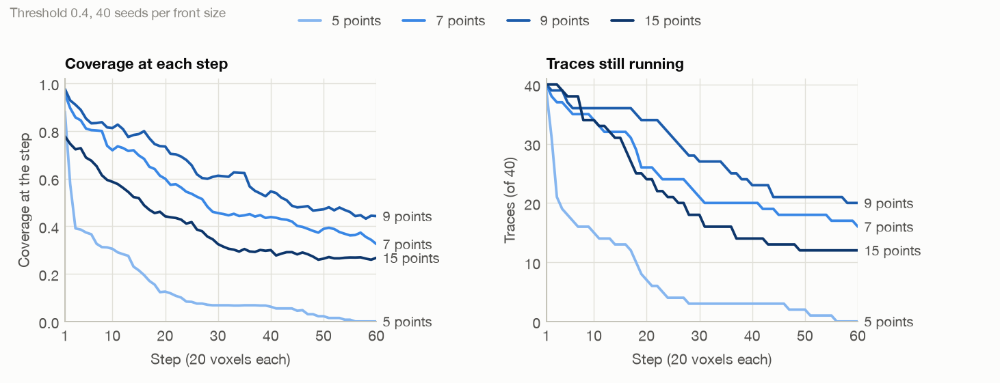
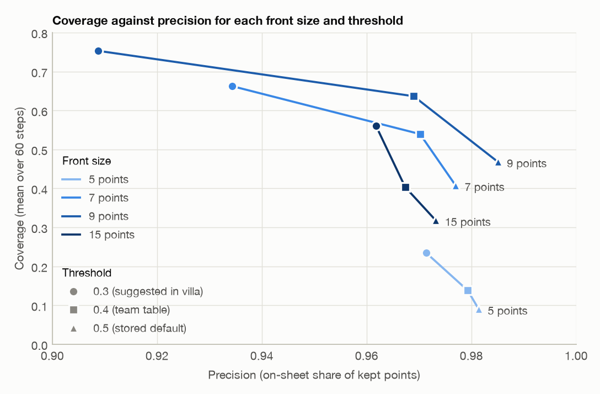

# How far the public sheet tracer gets on held-out PHerc0139

[](https://github.com/damsolanke/sheet-tracer-eval/actions/workflows/ci.yml) [](LICENSE)

Model: [`scrollprize/sheet_tracer_7pt_gap60`](https://huggingface.co/scrollprize/sheet_tracer_7pt_gap60), revision `443497f0`. Benchmark: [`evaluation/benchmark.py`](https://github.com/ScrollPrize/villa/blob/fe64ea3bbf4f4f775f202beae2b87812f2208553/vesuvius/src/vesuvius/neural_tracing/tracers/sheets/evaluation/benchmark.py) in [ScrollPrize/villa](https://github.com/ScrollPrize/villa) at `fe64ea3`.

Dam Solanke, October 2026 (section 7: November 2026)

I ran the public sheet tracer `scrollprize/sheet_tracer_7pt_gap60` through villa's own trace benchmark, unchanged, on the held-out slab of PHerc0139. That slab is level-2 z 4402 to 6234, the band villa's `prepare_scroll.py` keeps out of training by default. Every setting used 40 seeds and 60 steps of 20 voxels. I wanted two answers: how far a trace gets on data the model has not seen, and which settings someone tracing a new scroll should pick.

What I found:

- **Seed-row length decides most of the outcome.** At threshold 0.4, coverage is 0.14 with 5-point fronts, 0.54 with 7, 0.64 with 9 and 0.40 with 15, while precision stays between 0.967 and 0.979.
- **Traces seldom leave the sheet; they stop.** At 0.4, whenever a trace is running, 79 to 89 % of its scored points are kept on the right sheet at every front size. Coverage is lost when villa's tracer stops a trace whose newest row has no confident point left, and about half of the 5-point traces stop within three steps.
- **Threshold 0.3 beats the stored 0.5.** Going from 0.4 to 0.3, as villa's inference code suggests for this model, adds 0.10 to 0.16 coverage at every front size and costs 0.04 and 0.06 precision at 7 and 9 points.
- **A different run produced the published held-out table**, one trained on 5 to 16-point fronts. Against it, this checkpoint lands within the plan's tolerance at 9 points and falls short on coverage at 5 and 15.
- **Prize-eligible scans cost coverage.** On PHerc0139's 9.362 um scan, the protocol of 11 prize-eligible volumes, coverage drops by 0.03 to 0.08 even at the training voxel size. Reading that scan natively loses a further 0.03 to 0.05, with only one setting in four clear of noise. Presented at 8.64 um per voxel instead, the geometry of the other 11 eligible volumes, the scan loses 0.09 coverage against the resampled reading at 9 points and threshold 0.4, a loss that holds when rescored at equal micrometres. Its precision loss at 9 points and 0.3 is 0.035, about half of it from stricter scoring, and at 7 points resampling makes no measurable difference. These ran after the plan's gate had already said stop, so section 4 reports them as exploratory.
- **Long seed rows can be traced in 7-point pieces.** The model was trained on 7-point fronts, and tracing a longer row as overlapping 7-point pieces raised 15-point coverage at 0.4 from 0.405 to 0.584 over 77 seed pairs (+0.179, interval +0.124 to +0.234) with precision level, under a plan saved before the test. Section 7 has the numbers, including a first look at 21-point rows, where the unchanged tracer falls to 0.12.

What I would do with this:

- Seed with 7 or 9-point rows. With this checkpoint, 5-point rows stop almost at once.
- Trace rows longer than 9 points in 7-point pieces (`run_bench --piece-points 7 --piece-stride 2` here). Without them, coverage falls as the row grows.
- Trace at 0.3 when whatever reads the surface next can absorb a few more off-sheet points. At the stored 0.5, coverage falls at every front size.
- On 8.64 um volumes traced with 9-point rows, resampling to about 9.6 um first is the safer choice. Reading them natively costs most clearly at threshold 0.4; at 0.3 the evidence is weaker, and the resampled reading never scored lower in any of the four settings. villa's sheet-tracer inference has no voxel-size option, so resampling means writing a resampled copy of the volume. For 9.362 um volumes it is a small and uncertain gain.
- If the team publishes RESULTS.md or the `remote_l0_points_ft` weights, anyone can check a harness against the run behind the table.

## What I evaluated

| Item | Value |
|---|---|
| Model | `scrollprize/sheet_tracer_7pt_gap60`, revision `443497f0`, `last.pt` (sha256 `b1d133bc...53ec`); EMA weights, as villa's loader picks them; fp32 |
| Run inside the checkpoint | `remote_l0_neighbor`, iteration 24,682, 20.0 M parameters. Trained on 7-point fronts only (`front_points 7`, no `front_points_range`), points 60 vx apart, steps of 20 vx; stored confidence threshold 0.5 |
| Code | villa `fe64ea3` (main on Oct 21). `evaluation/benchmark.py` runs unchanged inside a thin wrapper that records chunk reads and per-trace counts |
| Data | PHerc0139, 2.399 um 78 keV scan `20260102150214` read at level 2 (about 9.6 um voxels, the training protocol). 38 registered segments; held-out band z 4402.4 to 6233.6 (the middle 20 % of their z extent); 37 held-out patches built with `prepare_scroll.py`'s rules |
| Eligible scan (section 4) | PHerc0139, 9.362 um 1.2 m 113 keV scan `20250728140407` (Paganin 1000, the protocol of 11 of the 22 prize-eligible volumes), mapped to the held-out patches by an affine fitted with CT block matching; residual 0.18 voxels median inside the slab |
| Seeds | 40 per front size from 23 to 26 of the 37 patches (at most 4 per patch), drawn by the benchmark's own `draw_seeds` with its fixed generator, `--all-val --max-per-patch 0 --min-valid 0.95`; identical seeds at every threshold |
| Settings | 60 steps; fronts of 240, 360, 480 and 840 vx (5, 7, 9 and 15 points); thresholds 0.3, 0.4 and 0.5 |
| Hardware | Apple M4 Max, PyTorch 2.14.1 on MPS, fp32. On two-seed checks MPS and CPU kept the same 1,428 of 1,428 points, on the training scan and on the resampled 8.64 um path. Sections 1 to 3 took 531 s for twelve runs, section 4 554 s for twelve more |
| Data check | Every chunk a trace read was on disk, or absent from the bucket because it is masked air. No run read zeros where real CT exists |

The metrics are villa's. Coverage is the share of scored points that are kept and lie on the seed's sheet (within 6 vx), per step, averaged over the 60 steps; rows after an early stop count as not covered. Precision is the on-sheet share of kept points. A real switch is a row with three or more kept off-sheet points, or one kept point more than 9 vx off. Intervals are 95 % bootstraps over seeds (2,000 resamples), and threshold changes use paired bootstraps over the same seeds.

## 1. Front size and threshold

| Points | Threshold | Coverage | Precision | Real switches (of 40) | Stopped early (of 40) | Steps traced, median | Coverage over traced rows |
|---|---|---|---|---|---|---|---|
| 5 | 0.3 | 0.235 (0.144 to 0.334) | 0.971 (0.951 to 0.986) | 12 | 36 | 6.5 | 0.844 |
| 5 | 0.4 | 0.138 (0.084 to 0.199) | 0.979 (0.922 to 0.995) | 5 | 40 | 3 | 0.798 |
| 5 | 0.5 | 0.090 (0.055 to 0.135) | 0.981 (0.932 to 0.997) | 3 | 40 | 2 | 0.775 |
| 7 | 0.3 | 0.662 (0.554 to 0.760) | 0.934 (0.879 to 0.975) | 28 | 19 | 60 | 0.872 |
| 7 | 0.4 | 0.539 (0.424 to 0.655) | 0.970 (0.941 to 0.989) | 21 | 24 | 35.5 | 0.864 |
| 7 | 0.5 | 0.408 (0.294 to 0.518) | 0.977 (0.943 to 0.995) | 15 | 30 | 19.5 | 0.846 |
| 9 | 0.3 | 0.753 (0.656 to 0.837) | 0.909 (0.851 to 0.957) | 32 | 13 | 60 | 0.860 |
| 9 | 0.4 | 0.637 (0.529 to 0.735) | 0.969 (0.950 to 0.984) | 26 | 20 | 58.5 | 0.885 |
| 9 | 0.5 | 0.468 (0.358 to 0.581) | 0.985 (0.976 to 0.992) | 23 | 28 | 25.5 | 0.862 |
| 15 | 0.3 | 0.560 (0.452 to 0.663) | 0.962 (0.943 to 0.976) | 37 | 22 | 45 | 0.841 |
| 15 | 0.4 | 0.403 (0.304 to 0.504) | 0.967 (0.949 to 0.981) | 28 | 28 | 26 | 0.786 |
| 15 | 0.5 | 0.318 (0.231 to 0.409) | 0.973 (0.947 to 0.989) | 26 | 32 | 21.5 | 0.743 |

Two columns barely move. Precision stays between 0.909 and 0.985, and coverage over the rows a trace actually reached stays between 0.74 and 0.89. Most of the movement is in how many rows get traced at all. villa's `trace` stops at the first row in which no confident point connects to the surface traced so far, and the benchmark counts every later row as uncovered. So a stop costs as much as a wrong sheet.

With 5-point fronts the tracer rarely gets going: at 0.4, 21 of the 40 traces stop after three traced steps or fewer, and none runs the full 60. With 7 and 9 points (the trained front size and the next one up), 16 and 20 traces run all 60 steps at the same threshold. Fronts of 15 points stop more often again and collect the most real switches, 28 of 40 at 0.4. Because the benchmark draws seeds per front length, seeds differ between front sizes and the sizes compare only through their intervals. At 0.4 those intervals separate 5 points from every other size, and 15 points from 9.



*Figure 1. Threshold 0.4, 40 seeds per front size. Left: coverage at each step, pooled over the seeds as villa pools it. Right: traces still running, out of 40.*

## 2. Against the team's held-out table

| Points | This checkpoint at 0.4: coverage / precision | Team table, `remote_l0_points_ft`: coverage / precision |
|---|---|---|
| 5 | 0.138 / 0.979 | 0.457 / 0.980 |
| 9 | 0.637 / 0.969 | 0.605 / 0.980 |
| 15 | 0.403 / 0.967 | 0.548 / 0.957 |

The only published held-out numbers for the sheet tracers are in villa's OPERATIONS.md (state of Oct 7, H100, bf16, 60 steps, threshold 0.4). They belong to `remote_l0_points_ft`, an 18.5 M parameter run trained on 5 to 16-point fronts, not to the released checkpoint. RESULTS.md, which holds the commands behind that table, is not in the repository, so its seed count, patch set and scoring options are unknown.

The plan for this evaluation, written on Oct 21 before any result, used that table as a harness check: at threshold 0.4 the harness had to land within 0.12 coverage and 0.04 precision of the team's row at 5, 9 and 15 points. Only the 9-point column passes. Both others fall short on coverage (0.138 against a floor of 0.337 at 5 points, 0.403 against 0.428 at 15). Under that rule the planned follow-up stopped: the same benchmark on PHerc0139's prize-eligible 9.362 um scan, read natively, resampled to the training voxel, and at 8.64 um geometry. Later I ran it under a disclosed amendment, and section 4 reports it as exploratory.

I do not think the shortfall is a harness fault. Faults of that kind (wrong voxel units, misregistered patches, CT read as zeros) push points off the sheet and lower precision too. Here precision is within 0.011 of the team's at every size, and kept on-sheet points lie a median 1.0 to 1.1 vx from the labelled sheet. More likely, the training difference explains it: this checkpoint has only seen 7-point fronts. One thing I could not test is bf16 autocast on CUDA, which the team used.

## 3. Threshold

villa's inference code calls 0.3 this model's best threshold, while the checkpoint stores 0.5. Paired changes against 0.4 on the same 40 seeds:

| Points | 0.3: coverage | 0.3: precision | 0.5: coverage | 0.5: precision |
|---|---|---|---|---|
| 5 | +0.097 (+0.043 to +0.160) | -0.008 (-0.020 to +0.042) | -0.048 (-0.095 to -0.016) | +0.002 (-0.042 to +0.031) |
| 7 | +0.123 (+0.077 to +0.176) | -0.036 (-0.087 to -0.005) | -0.132 (-0.187 to -0.085) | +0.007 (-0.002 to +0.018) |
| 9 | +0.116 (+0.072 to +0.163) | -0.060 (-0.111 to -0.016) | -0.168 (-0.244 to -0.107) | +0.016 (+0.006 to +0.029) |
| 15 | +0.157 (+0.080 to +0.235) | -0.006 (-0.016 to +0.005) | -0.085 (-0.138 to -0.041) | +0.006 (-0.014 to +0.024) |

At 0.3 coverage rises at every front size, and precision drops at 7 and 9 points; at 5 and 15 points the precision change is within noise. At 0.5, the stored default, coverage falls everywhere, and precision gains only at 9 points (+0.016). So 0.3 buys 0.10 to 0.16 coverage for at most 0.06 precision, with more real switches (28 against 21 at 7 points). Which side of that trade is right depends on what reads the surface next.



*Figure 2. Section 1's table as a trade-off: one line per front size, running from threshold 0.5 at the lower right through 0.4 to 0.3 at the upper left. Paired intervals for these changes are in the table above.*

## 4. The prize-eligible scan (exploratory)

> **Exploratory.** These runs came after the gate in section 2 said NO-GO. Before any of them ran, an amendment written into the plan (PLAN.md section 9) allowed them and fixed their scope: 7 and 9 points, thresholds 0.4 and 0.3, and the comparisons and reading the plan had set on Oct 21.

PHerc0139 was also scanned at 9.362 um (1.2 m, 113 keV, Paganin 1000), the protocol of 11 of the 22 prize-eligible volumes; the other 11 are 8.64 um scans. Three conditions read that scan on the 40 seeds of section 1. C1 reads it natively, so one model voxel is 9.362 um, 2.8 % smaller than the training voxel. C3 resamples it on the fly to the training frame, where one model voxel is 9.63 um of this scan: the scale the affine measures between the two scans (the training scan's nominal level-2 voxel is 2.399 x 4 = 9.596 um). C2 presents it at 8.64 um per voxel, the geometry of an 8.64 um volume read natively. Held-out patches reach each frame through an affine fitted by CT block matching between the two scans, with a median residual of 0.18 voxels inside this slab, and every crop sample is a single trilinear read of the 9.362 um scan. Steps, crops and the same-sheet tolerance stay in model voxels, as the checkpoint defines them. All 40 seeds survived in every run.

Coverage / precision:

| Points | Threshold | Training scan (C0) | 9.362 um scan resampled to 9.63 um (C3) | 9.362 um native (C1) | 8.64 um geometry (C2) |
|---|---|---|---|---|---|
| 7 | 0.4 | 0.539 / 0.970 | 0.463 / 0.934 | 0.419 / 0.970 | 0.439 / 0.894 |
| 7 | 0.3 | 0.662 / 0.934 | 0.578 / 0.903 | 0.548 / 0.901 | 0.526 / 0.862 |
| 9 | 0.4 | 0.637 / 0.969 | 0.602 / 0.961 | 0.555 / 0.958 | 0.511 / 0.940 |
| 9 | 0.3 | 0.753 / 0.909 | 0.707 / 0.917 | 0.662 / 0.919 | 0.681 / 0.881 |

Paired changes in coverage on the same 40 seeds (95 % paired bootstrap):

| Points | Threshold | Eligible scan at equal voxel (C3 against C0) | 9.362 um native (C1 against C3) | 8.64 um geometry (C2 against C3) |
|---|---|---|---|---|
| 7 | 0.4 | -0.076 (-0.131 to -0.025) | -0.044 (-0.116 to +0.017) | -0.024 (-0.105 to +0.044) |
| 7 | 0.3 | -0.084 (-0.145 to -0.029) | -0.030 (-0.089 to +0.021) | -0.051 (-0.133 to +0.018) |
| 9 | 0.4 | -0.034 (-0.094 to +0.025) | -0.047 (-0.099 to +0.001) | -0.091 (-0.174 to -0.025) |
| 9 | 0.3 | -0.046 (-0.089 to -0.003) | -0.045 (-0.090 to -0.010) | -0.026 (-0.087 to +0.030) |

Paired changes in precision:

| Points | Threshold | C3 against C0 | C1 against C3 | C2 against C3 |
|---|---|---|---|---|
| 7 | 0.4 | -0.036 (-0.124 to +0.010) | +0.036 (-0.009 to +0.125) | -0.039 (-0.144 to +0.048) |
| 7 | 0.3 | -0.031 (-0.118 to +0.044) | -0.002 (-0.107 to +0.097) | -0.041 (-0.131 to +0.040) |
| 9 | 0.4 | -0.008 (-0.028 to +0.010) | -0.003 (-0.017 to +0.010) | -0.021 (-0.054 to +0.010) |
| 9 | 0.3 | +0.008 (-0.017 to +0.034) | +0.002 (-0.025 to +0.042) | -0.035 (-0.062 to -0.012) |

The plan's reading, fixed on Oct 21: resampling is recommended for a voxel size if its coverage change against C3 has an interval below zero, or if its precision drops by 0.01 or more with an interval below zero; otherwise the guidance is "no measurable effect at this sample size". Applied setting by setting:

| Points | Threshold | 9.362 um volumes | 8.64 um volumes |
|---|---|---|---|
| 7 | 0.4 | no measurable effect | no measurable effect |
| 7 | 0.3 | no measurable effect | no measurable effect |
| 9 | 0.4 | no measurable effect | resample (coverage) |
| 9 | 0.3 | resample (coverage) | resample (precision) |

The settings disagree, so neither voxel size gets a clean verdict. For 9.362 um volumes the four coverage changes all point the same way (-0.030 to -0.047), yet only one interval clears zero. Reading them natively costs little, and resampling to about 9.6 um is a small and uncertain gain. For 8.64 um volumes both 9-point settings call for resampling and both 7-point settings do not, with wider intervals at 7 points.

The scan itself matters about as much as its voxel size. Even at the training voxel, the eligible scan costs coverage: 0.03 to 0.08 below the training scan, with intervals below zero in three settings of four and precision within noise. Against the training scan, native 9.362 um reading loses 0.08 to 0.12 coverage and 8.64 um geometry 0.07 to 0.14, every interval below zero. Since villa's sheet-tracer inference reads a volume as it is, with no voxel-size option, resampling means writing a resampled copy of the volume first.

One check falls outside the plan. It concerns villa's same-sheet tolerance of 6 model voxels, which is 51.8 um in C2 and 56.2 um in C1 against 57.8 um in C3, so part of a C1 or C2 loss could be stricter scoring. Rescored at the tolerance that equals C3's in micrometres (each rescored run first reproduces its own counts at 6 voxels), the 9.362 um pattern stays as it is, and the 8.64 um coverage loss at 9 points and 0.4 holds (-0.085, from -0.168 to -0.019). By contrast, the 8.64 um precision loss at 9 points and 0.3 shrinks to -0.019 (-0.045 to +0.003), so part of that one came from the stricter scoring.

## 5. Limitations

- One scroll, one held-out slab, 40 seeds per setting. Seeds share patches (23 to 26 of 37, up to 4 seeds each), so intervals that treat seeds as independent are somewhat narrow.
- fp32 on Apple MPS against the team's bf16 on H100. MPS matched CPU fp32 exactly on two seeds; I did not try bf16.
- `prepare_scroll.py`'s default band defines the held-out slab. Although the checkpoint's config lists `unseen/PHerc0139/train_patches`, the training half that script writes, the team's data folder is not public, so I could not confirm the split used in training.
- Rows after a stop count as uncovered, as villa defines coverage. A traced-row column separates stopping from leaving the sheet.
- Section 4 is exploratory. It ran after the gate's NO-GO, at 7 and 9 points and thresholds 0.4 and 0.3 only, and its four settings disagree. Its eligible scan is of a training scroll (PHerc0139; the slab itself was held out), and 8.64 um is simulated by presenting the 9.362 um scan at that voxel size, not read from a real 8.64 um scan.
- An affine registers the two scans: residual shift 0.18 voxels median and 0.41 at the 90th percentile over 300 blocks of 48^3 voxels in the slab. Any misregistration left weighs on C3 against the training scan more than on the comparisons among C1, C2 and C3, which share the same affine.

## 6. Rerun

From the repository root, with a `.venv` built from `requirements.txt` (villa `fe64ea3` source at `$VILLA_SRC`; CT mirrors of the two PHerc0139 volumes under `$VESUVIUS_DATA/zarr`, linked as level `0` of the volume folders in `$TRACEREVAL_DATA/volumes`; `$TRACEREVAL_DATA` holds the prepared patches and the runs; C1 to C3 read the fitted affine from [winding-model-eval](https://github.com/damsolanke/winding-model-eval), cloned next to this repository as `windeval`):

```bash
uv venv --python 3.14 .venv && uv pip install --python .venv/bin/python -r requirements.txt
source .venv/bin/activate
git clone https://github.com/ScrollPrize/villa ../villa && git -C ../villa checkout fe64ea3
export VILLA_SRC=$(cd ../villa/vesuvius/src && pwd)
git clone https://github.com/damsolanke/winding-model-eval ../windeval
hf download scrollprize/sheet_tracer_7pt_gap60 last.pt --revision 443497f0f584f6b3e414b4379c6ad4ed1d7faacc \
    --local-dir $VESUVIUS_DATA/hf/sheet_tracer_7pt_gap60
mkdir -p $TRACEREVAL_DATA/logs $TRACEREVAL_DATA/volumes/PHerc0139_2399um_l2.zarr $TRACEREVAL_DATA/volumes/PHerc0139_9362um.zarr
ln -s $VESUVIUS_DATA/zarr/PHerc0139/volumes/20260102150214-2.399um-0.2m-78keV-masked.zarr/2 \
    $TRACEREVAL_DATA/volumes/PHerc0139_2399um_l2.zarr/0
ln -s $VESUVIUS_DATA/zarr/PHerc0139/volumes/20250728140407-9.362um-1.2m-113keV-masked.zarr/0 \
    $TRACEREVAL_DATA/volumes/PHerc0139_9362um.zarr/0
python -m tracereval.prepare --scroll PHerc0139 --volume-id 20260102150214 --coord-scale 0.25 \
    --level-dir $TRACEREVAL_DATA/volumes/PHerc0139_2399um_l2.zarr/0 --parts heldout \
    --out $TRACEREVAL_DATA/prepared/PHerc0139_2399l2_A0slab
python -m tracereval.grid --cond C0 --fronts 240 480 840 360 --thresholds 0.4 0.3 0.5 --device mps --threads 2
python -m tracereval.analyze gate --team 0.457,0.980 0.605,0.980 0.548,0.957 \
    --runs RUNS/A0_C0_f240_t0.4 RUNS/A0_C0_f480_t0.4 RUNS/A0_C0_f840_t0.4
python -m tracereval.c0_table --runs-dir RUNS --out RUNS/A0_C0_table.json
python -m tracereval.grid --cond C3 C1 C2 --fronts 360 480 --thresholds 0.4 0.3 --device mps --threads 2
python -m tracereval.c123_table --runs-dir RUNS --out RUNS/A0_C123_table.json
```

The tolerance check of section 4 runs `python -m tracereval.rescore_tol RUN --tolerance T` on each C1 run (T = 6.1698) and each C2 run (T = 6.6854). `RUNS` is `$TRACEREVAL_DATA/runs`. Each run folder holds villa's `report.json` and the traces as tifxyz, plus `run_meta.json` (arguments, commits, chunk reads) and `per_trace.json` (the counts behind every interval).

Here, `results/` holds `report.json`, `run_meta.json` and `per_trace.json` for all 24 runs (without the tifxyz traces) and the three tables. It also holds the checks quoted in the text: `per_trace_tol*.json` and `A0_C123_tolerance_sensitivity.json` (the tolerance check of section 4), `A0_numerics_check.json` and `A0_numerics_C2_check.json` (MPS against CPU), and `affine_check_slab.json` (the registration residuals). `python -m pytest tests` rebuilds the tables from those counts and compares every number; `python scripts/make_figures.py` redraws both figures.

## 7. Long seed rows: trace them as overlapping 7-point pieces

This checkpoint was trained on 7-point fronts, and section 1 shows what longer rows cost it: at threshold 0.4, coverage is 0.64 with 9-point rows but 0.40 with 15. So I tried keeping the model on the front length it knows. `tracereval/pieces.py` traces a row of more than 7 points as 7-point pieces that start every 2 points (the last piece ends on the last point), each with villa's own `trace` and its stock options. Then the pieces are merged column by column: at each step, a dense column comes from the piece that is still tracing and holds it closest to its own centre, and a column that no piece covers any more keeps its last position at confidence 0, as the benchmark pads a stopped trace. Nothing else changes. Model, weights, step, threshold and `connected_keep` are all stock, and villa's benchmark scores the merged points. `run_bench --piece-points 7 --piece-stride 2` turns it on; without the option, the runner reproduces every released run byte for byte.

I chose the stride on 40 tuning windows at 15 points, all disjoint from the test windows (stride 2 +0.133 coverage, 4 +0.108, 6 +0.116), then wrote [PLAN_PIECES.md](PLAN_PIECES.md) before any test run. My test compares pieces with stock at threshold 0.4 on the same seeds: the 40 released test seeds at 15 points, pooled with 45 fresh windows that share no part of their GT window with any test, tuning or other fresh window. Eight fresh windows dropped out because a run read CT that is missing from my local mirror, under the plan's limit of a quarter.

| 15 points, threshold 0.4 | Pairs | Coverage, stock to pieces | Change [95 % CI] | Precision change | Real switches |
|---|---|---|---|---|---|
| Pooled | 77 | 0.405 to 0.584 | **+0.179** [+0.124, +0.234] | -0.000 | 61 to 65 |
| Released test seeds | 40 | 0.403 to 0.626 | +0.223 [+0.146, +0.302] | +0.001 | 28 to 30 |
| Fresh windows | 37 | 0.408 to 0.538 | +0.130 [+0.062, +0.207] | -0.008 | 33 to 35 |

Every rule of the plan holds: the pooled interval lies above zero, both parts gain on their own, precision is level, and the switch count stays inside its limit (61 plus 10 % of the pairs). Seven-point rows pass through the wrapper unchanged, as they should (its `per_trace.json` equals the released run's), and at 9 points the change is within noise (-0.012 [-0.063, +0.034]). Reported only: at threshold 0.3, 15-point coverage rises from 0.560 to 0.744 for 0.038 precision.

After the decision I looked at two more row lengths, 40 windows each from the benchmark's own draw. They are exploratory:

| Row length | Pairs | Coverage, stock to pieces | Change [95 % CI] | Precision change |
|---|---|---|---|---|
| 13 points | 40 | 0.503 to 0.632 | +0.129 [+0.057, +0.208] | -0.012 |
| 21 points, runs that read only cached CT | 27 | 0.117 to 0.563 | +0.446 [+0.340, +0.559] | -0.040 |

On 21-point rows the unchanged tracer almost stops working, and the pieces bring it back to about the 15-point level. My stock 21-point run read 150 chunks that are missing locally, because each step reads the bounding box of the whole front, so the table keeps only the 27 windows with no such read; on them the stock coverage is still 0.117.

`results/long_rows/` holds the report, run metadata and per-trace counts of every run above, and `python -m tracereval.pieces_table` rebuilds both tables from them (`tests/test_pieces_table.py` checks every number). Seed files in that folder name the patch folder as `~/kaggle-data/...`; point it at your own prepared patches before reusing them.

## Data and license

CT volumes and segment meshes are Vesuvius Challenge open data under CC BY-NC 4.0. None of them is included here; the runs read them from local copies of the public bucket.
